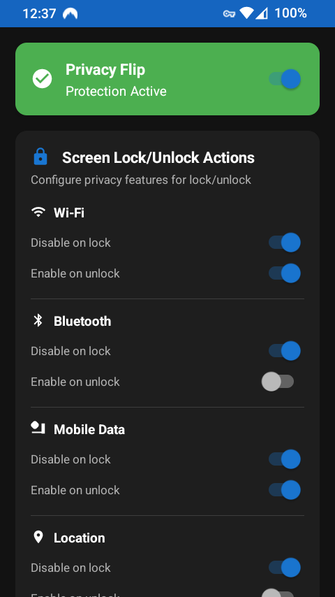
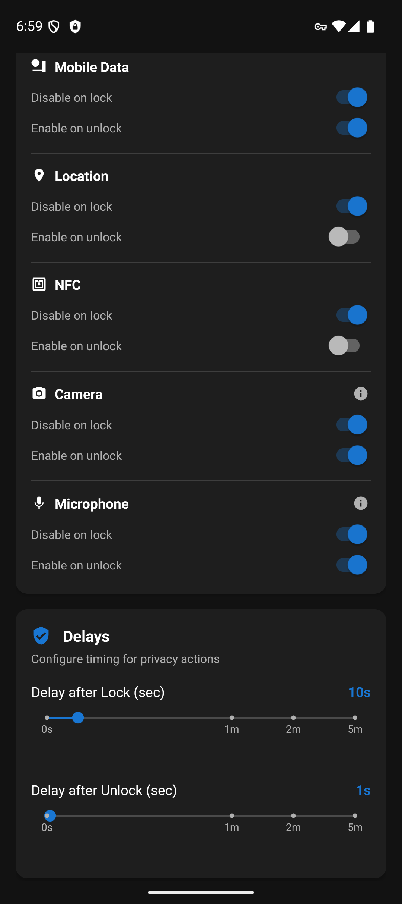

# PrivacyFlip

**Automatic lock/unlock privacy control for Android devices 🔐📱✨**

**PrivacyFlip** automatically manages your Android device's privacy features based on lock/unlock state. When you lock your device, it can disable **Wi-Fi**, **Bluetooth**, **mobile data**, **location** services, **NFC**, and even **camera/microphone sensors**. When you unlock, it intelligently restores the features you want back on.

**Works with Sui, Root, Dhizuku or Shizuku** - Choose your preferred privilege method!

   
   
  

## 📸 Screenshots

  
  

## 🔒 Features

### **Automatic Privacy Control**
- **Lock Detection**: Disables privacy features when the screen locks, after your lock delay (camera and microphone at once)
- **Unlock Detection**: With a PIN, pattern or password, waits until you unlock it. With no secure lock, turning the screen on counts as unlocking
- **Smart Restoration**: Configurable feature re-enabling on unlock. With Dhizuku, some features cannot follow this setting (see Option 3)

### **Privacy Features Controlled**
- 📶 **Wi-Fi** - Disable/enable wireless connectivity
- 📱 **Bluetooth** - Control Bluetooth radio
- 📡 **Mobile data** - Manage cellular data connection
- 📍 **Location services** - Control GPS and location tracking
- 📳 **NFC** - Control Near Field Communication sensor
- 📷 **Camera** - Disable/enable camera sensor privacy (Android 12+)
- 🎤 **Microphone** - Disable/enable microphone sensor privacy (Android 12+)
- ✈️ **Airplane Mode** - Enable airplane mode on lock (opt-in, disables all radios)
- 🔋 **Battery Saver** - Enable battery saver mode on lock (opt-in)

### **Advanced Features**
- **Smart Disable Options**:
  - **"Only if unused/not connected"** - Don't disable WiFi, Bluetooth, or Location if actively in use, or Mobile Data while media is playing. The microphone is not disabled during a phone or VoIP call. While a Wi-Fi hotspot is on, Wi-Fi, mobile data and Airplane Mode are always left alone
  - **"Only if not already enabled"** - Prevent connection resets by not re-enabling features that are already on
  - **"Only if Privacy Flip turned it on"** - On unlock, turn Airplane Mode or Battery Saver off only if Privacy Flip turned it on

- **App Exemptions** - If an exempt app is in front when the phone locks, nothing is disabled. Unlock always runs. Needs Usage Access
- **NFC Auto-Retry** - Opt-in: if a payment or wallet app turns NFC back on right after Privacy Flip turns it off, retry disabling it
- **Keep Off While Locked** - Opt-in: if Wi-Fi, Bluetooth, mobile data, location or NFC is switched back on before you unlock (for example from Quick Settings), or Airplane Mode or Battery Saver is switched off, Privacy Flip runs its lock actions again, with the same "only if" rules; camera and microphone cannot change while locked. It puts back only what Privacy Flip itself turned off, at most 5 times per lock, and only while the background service runs
- **Accessibility Service** - Experimental, opt-in: an extra lock and unlock signal from the lock screen window (requires Accessibility permission). It does not make camera and microphone work with an instant power-button lock: Android refuses that once the phone is locked
- **Quick Settings tile and home screen widget** - Turn protection on and off. Turning it off needs an unlocked phone
- **Advanced Detection** - Multi-tier Bluetooth connection detection prevents unwanted headphone disconnects

### **Customizable Timing**
- **Lock Delay**: 0-60 seconds (granular), 2 minutes, or 5 minutes before privacy actions trigger
- **Unlock Delay**: 0-60 seconds (granular), 2 minutes, or 5 minutes before features are restored
- **Instant Mode**: Set delays to 0 for immediate action
- **Note**: Camera and microphone ignore custom delays and trigger immediately, due to Android limitations

## 📱 Requirements

**Minimum:** Android 8.0+ (API level 26)
**Camera/Microphone Features:** Android 12+ (API level 31)

**Choose your privilege method:**

### **Option 1: Shizuku** (No root required!)
- **Shizuku** app installed and running
- **ADB privileges** via USB debugging or wireless ADB
- **No root required** - works with ADB-level permissions

### **Option 2: Root Access** (Recommended for rooted devices)
- **Root access** via Magisk, SuperSU, or similar
- **Best performance** with UID 0 privileges

### **Option 3: Dhizuku** (Device Owner method, 5 of 9 features)
- **Device Owner** status. Android refuses to set a Device Owner on a device that already has a
  second user, such as a work profile
- **No root required**, no ADB needed after initial setup
- **Persistent privileges** - survives reboots
- **Works for**, and each needs its own Android version:
  Camera and Microphone (Android 12+), Bluetooth (Android 9+), Location (Android 11+),
  NFC (Android 15+). Below Android 9 a Dhizuku setup can switch nothing at all.
- **Cannot do**: WiFi, Mobile Data, Airplane Mode, Battery Saver. Dhizuku shares Device Owner
  rights, and Android gives a Device Owner no way to switch those. Use Root or Shizuku for them.
- **At unlock**: NFC, camera and microphone always come back on. Bluetooth never does: turn it on yourself

### **Option 4: Sui** (Best of both worlds)
- **Rooted device** with Magisk installed
- **Sui Magisk** module installed
- **Best user experience** - no permission prompts, automatic startup

### **Privilege Detection Priority**
1. **Sui** - Magisk module providing Shizuku API with root (best UX)
2. **Root** - Traditional root access via Magisk/SuperSU
3. **Dhizuku** - Device Owner method (no root or ADB needed after setup)
4. **Shizuku** - ADB privileges via Shizuku app

## 🤝 Contributing

Help make this app better. No contribution is too small!

### How to Contribute

1. **Fork the repository**
2. **Create a feature branch** (`git checkout -b feature/amazing-feature`)
3. **Make your changes**
4. **Commit your changes** (`git commit -m 'Add some amazing feature'`)
5. **Push to the branch** (`git push origin feature/amazing-feature`)
6. **Open a Pull Request**

All contributions are **valued** and **appreciated**!

## 📄 License

This project is licensed under the MIT License - see the [LICENSE](LICENSE) file for details.

## 💖 Support Development

PrivacyFlip protects your privacy. You can protect its future!

---

*Late nights for brighter days*

Created by Doru Moraru
